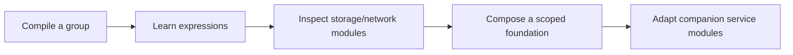

# Bicep Overview

[brown9804](https://github.com/brown9804) | Atlanta, USA

**Understand the template before creating infrastructure.**

Start with offline compilation, learn resource scopes and typed module
interfaces, and review proposed Azure changes before choosing a live deployment.

[Start learning](getting-started.md){ .md-button .md-button--primary }
[Explore Bicep for Everyone](companion-library.md){ .md-button }

## Find your next step

| Your goal | Start here | Build toward |
| --- | --- | --- |
| Understand Azure IaC | [Fundamentals](fundamentals.md) | [First compilation](getting-started.md) |
| Learn the language | [Parameters/expressions](language.md) | [Resources/scopes](resources-scopes.md) |
| Reuse building blocks | [Module interfaces](modules.md) | [Modular foundation](project.md) |
| Deploy deliberately | [Validation and what-if](deployment.md) | [Security/cost review](security-costs.md) |
| Explore Azure services | [Example catalog](catalog.md) | [Companion module library](companion-library.md) |
| Resolve a problem | [Troubleshooting](troubleshooting.md) | [Official references](resources.md) |

## Overview versus companion library

This repository teaches a focused sequence with five small original entry
points. **[Bicep for Everyone](https://github.com/Cloud2BR-MSFTLearningHub/Bicep-For-Everyone)**
provides broader tutorials, reusable service modules, architectures, and
projects. It is the structural/visual reference and the next learning resource,
not a catalog copied into this overview.

## What the examples do

The language example declares no workload resources. The foundation creates
network/storage infrastructure only if you explicitly run live commands.
No running application, production landing zone, or complete private
connectivity is implied.

## What automation checks

CI checks compilation/lint, compiled-template contracts, parameter files,
documentation synchronization, strict website builds, and internal links.
It publishes documentation, **not Azure resources**.
Live RBAC, policy, quota, APIs, availability, connectivity, and application
readiness require authorized environment-specific validation.

Continue through the [learning paths](learning-paths.md) or
[contribute an improvement](contributing.md).
