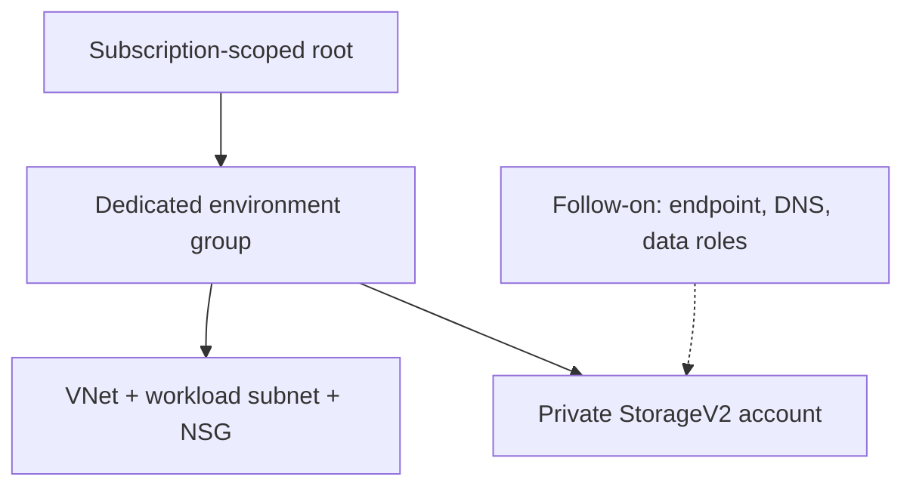

# Modular environment foundation

## Purpose and architecture

A subscription-scoped root creates a dedicated environment resource group.
Two local modules deploy a VNet/subnet/NSG and a private storage account into
that group. Module scope and resource references express dependencies.



This is a foundation lab, not a landing zone, running application, or complete
private-connectivity solution. Both dev and prod parameter files are learning
examples; the prod label is not a production certification.

## Prerequisites, inputs, and outputs

Offline: Azure CLI/Bicep and a non-secret sample `BICEP_STORAGE_NAME` for
parameter compilation. Live: approved subscription/group permissions,
regional policy/availability review, a unique storage name, budget and cleanup
owner, and no conflicting resources in the target group.

`prefix`/`environment` derive group/VNet names. `location` selects resources'
region; deployment metadata location is a separate CLI input.
`storageAccountName` is required. Outputs return the group name and module IDs.
Local dependencies are `modules/isolated-network` and `modules/private-storage`.

## Offline compilation

From the repository root, Bash:

```bash
export BICEP_STORAGE_NAME=stbicepoverviewci
az bicep build --file examples/03-modular-foundation/main.bicep --stdout
az bicep build-params --file examples/03-modular-foundation/dev.bicepparam --stdout
```

The artificial CI name is for compilation only; choose your own unique name
for live use. `readEnvironmentVariable` is evaluated by the parameter compiler,
not by ARM, so set it before compilation or deployment.
Parameter files are not secret stores.

## Optional live workflow

Use **your own** approved inputs and globally unique storage name:

```bash
az login
az account set --subscription "$SUBSCRIPTION_ID"
az account show --output table
export BICEP_STORAGE_NAME="$YOUR_UNIQUE_STORAGE_NAME"
az deployment sub validate --location eastus2 \
  --parameters examples/03-modular-foundation/dev.bicepparam
az deployment sub what-if --location eastus2 \
  --parameters examples/03-modular-foundation/dev.bicepparam
az deployment sub create --name bicep-overview-dev --location eastus2 \
  --parameters examples/03-modular-foundation/dev.bicepparam
```

The parameter file's `using` links the template, so a separate `--template-file`
is not needed with supported Azure CLI/Bicep versions.
Inspect what-if before create; no live deployment is part of CI.

## Expected results and verification

After an authorized successful deployment: one group, VNet, workload subnet,
NSG association, and storage account, plus deployment history.
Inspect `az resource list --resource-group rg-learn-dev` and the nested
deployment outputs. Storage should reject public-network and shared-key access.
It cannot serve applications until you add appropriate private access and roles.

## Cleanup, cost, and security

For default dev inputs, inspect **all** group contents before deletion:

```shell
az resource list --resource-group rg-learn-dev --output table
az group delete --name rg-learn-dev
```

Adjust the name if you changed inputs. Deletion removes all group resources;
do not use this on a shared environment. Verify removal and account for locks
or retained data. Deleting deployment history is not infrastructure cleanup.

Storage usage and later networking/workloads may incur costs. Compilation and
structural tests do not prove live permissions, policy, quotas, APIs,
connectivity, or application readiness. See the companion
[Bicep for Everyone library](https://github.com/Cloud2BR-MSFTLearningHub/Bicep-For-Everyone)
for broader modules, after reviewing their own prerequisites and limitations.
